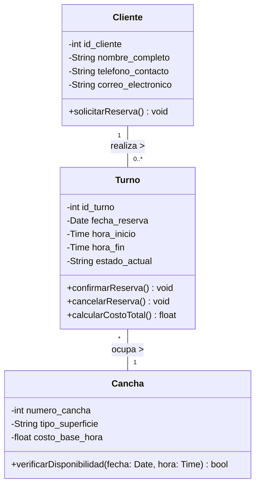

# Trabajo Práctico: Análisis Orientado a Objetos (AOO)
**Módulo:** Gestión de Reservas - Sistema Indoor Paddle

---

## 1. Selección del Requerimiento / Caso de Uso
Para el presente análisis se ha seleccionado el caso de uso central del sistema: **"Gestión y Reserva de Canchas"**. Este requerimiento abarca el proceso mediante el cual un cliente (actor) solicita la asignación temporal de una instalación deportiva (cancha) en un bloque de tiempo definido.

## 2. Identificación de Conceptos del Dominio
A partir de la narrativa del negocio, se realizó una extracción de los sustantivos y conceptos clave involucrados en el proceso de reserva. Los conceptos identificados en el dominio del problema son:
* *Cliente / Jugador*
* *Cancha / Pista deportiva*
* *Reserva / Turno*
* *Fecha y Horario*
* *Estado de la reserva (Pendiente, Confirmada, Cancelada)*
* *Sistema / Recepcionista*

## 3. Determinación de Clases
Tras un proceso de filtrado y abstracción, se descartaron los conceptos que representan características menores (atributos) o actores externos no modelables estructuralmente. Se determinaron las siguientes clases del modelo de dominio:

1. **`Cliente`**: Representa al actor principal que interactúa con el sistema para realizar la acción.
2. **`Cancha`**: Representa el recurso físico e inmueble del negocio que posee disponibilidad finita.
3. **`Turno`**: Representa el concepto abstracto y temporal que materializa el acuerdo entre el Cliente y la Cancha.

## 4. Identificación de Atributos
Se definieron los atributos estrictamente necesarios para satisfacer el requerimiento, asegurando el principio de encapsulamiento:

* **Clase `Cliente`**:
  * `id_cliente` (Identificador unívoco)
  * `nombre_completo`
  * `telefono_contacto`
  * `correo_electronico`
* **Clase `Cancha`**:
  * `numero_cancha`
  * `tipo_superficie` (Ej. Blindex, Muro)
  * `costo_base_hora`
* **Clase `Turno`**:
  * `id_turno`
  * `fecha_reserva`
  * `hora_inicio`
  * `hora_fin`
  * `estado_actual`

## 5. Identificación de Responsabilidades / Métodos
Asignación de comportamiento a las clases basándonos en el principio de "Experto en Información" (GRASP):

* **Clase `Cancha`**:
  * `verificarDisponibilidad(fecha, hora)`: La cancha es la experta en conocer sus propios huecos horarios disponibles.
* **Clase `Turno`**:
  * `confirmarReserva()`: Transiciona el ciclo de vida del turno.
  * `cancelarReserva()`: Libera el espacio asignado.
  * `calcularCostoTotal()`: Determina el monto final multiplicando su duración por el costo de la cancha.
* **Clase `Cliente`**:
  * `solicitarReserva()`

## 6. Establecimiento de Relaciones
Se identificaron las siguientes relaciones de asociación:
1. **Asociación Cliente - Turno:** Un cliente *realiza* uno o varios turnos.
2. **Asociación Turno - Cancha:** Un turno *ocupa* o bloquea una cancha determinada.

*(Nota: Se evita la relación directa Cliente-Cancha para disminuir el acoplamiento y porque la posesión de la cancha por parte del cliente es estrictamente temporal, delegando esta abstracción a la clase asociativa `Turno`)*.

## 7. Determinación de Multiplicidades
Se establecieron las restricciones cardinales basadas en las reglas de negocio:

* **`Cliente` (1) --- (0..*) `Turno`**: 
  * Un cliente puede registrarse en el sistema y no poseer ninguna reserva inicial (`0`), o puede ser un cliente frecuente con múltiples reservas en su historial (`*`).
* **`Turno` (*) --- (1) `Cancha`**: 
  * Una cancha registrará históricamente una multiplicidad de turnos a lo largo de su vida útil (`*`).
  * Sin embargo, un turno específico (en una fecha y hora exacta) solo puede ser asignado y pertenecer a una (y solo una) cancha física (`1`).

## 8. Construcción del Diagrama de Clases UML

## 9. Justificación Arquitectónica de las Decisiones
El modelo propuesto fue diseñado bajo los principios de la Programación Orientada a Objetos (SOLID). La decisión arquitectónica más relevante radica en la conceptualización de **`Turno` como una Clase propia (Clase Asociativa reificada)**, en lugar de modelar la fecha y hora como simples atributos dentro de `Cliente` o `Cancha`.

**Razones de esta decisión:**
1. **Ciclo de vida independiente:** El `Turno` posee estados dinámicos (Pendiente, Confirmado, Cancelado) que evolucionan en el tiempo. Un simple atributo no posee un ciclo de vida gestionable.
2. **Comportamiento propio:** Al convertirlo en clase, se le delega la responsabilidad de calcular métricas de negocio (como el costo total basado en su duración), respetando el principio de Responsabilidad Única (SRP).
3. **Escalabilidad:** Si en el futuro el sistema requiere reservas "multicancha" o eventos corporativos, desacoplar el concepto temporal de los recursos físicos permitirá adaptar el software sin incurrir en refactorizaciones estructurales profundas.
